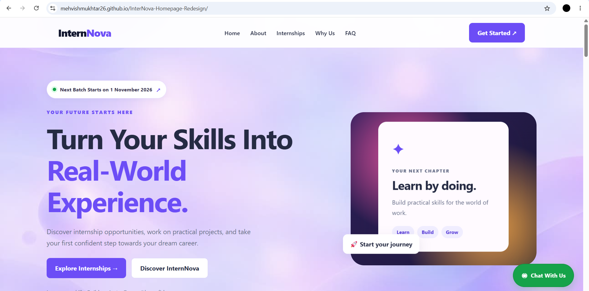
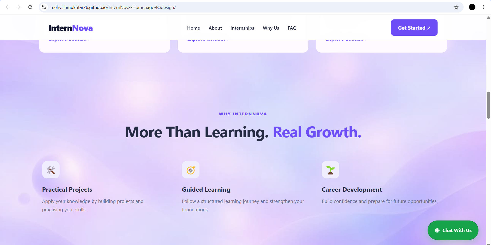
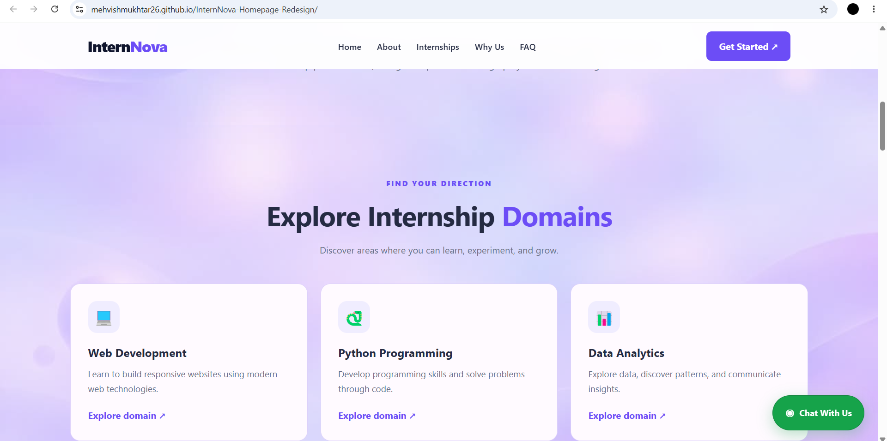
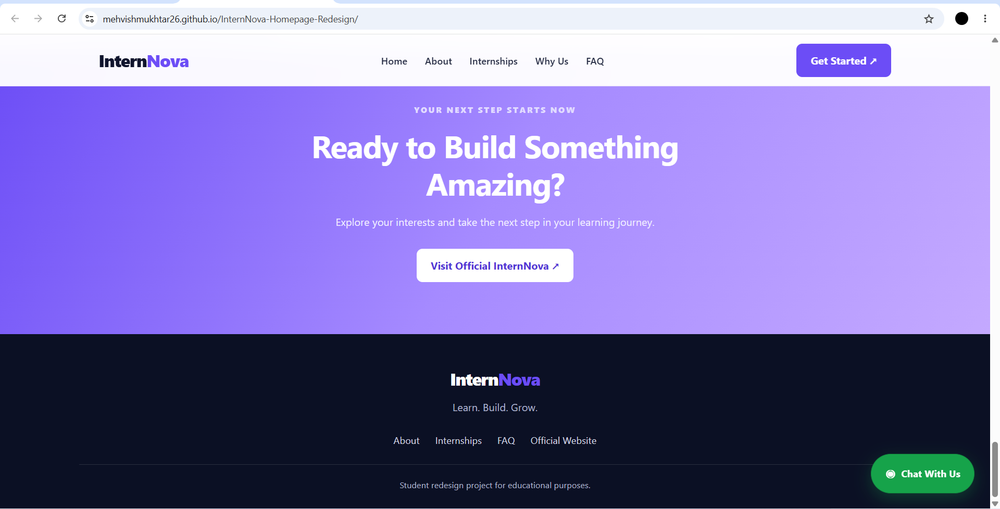
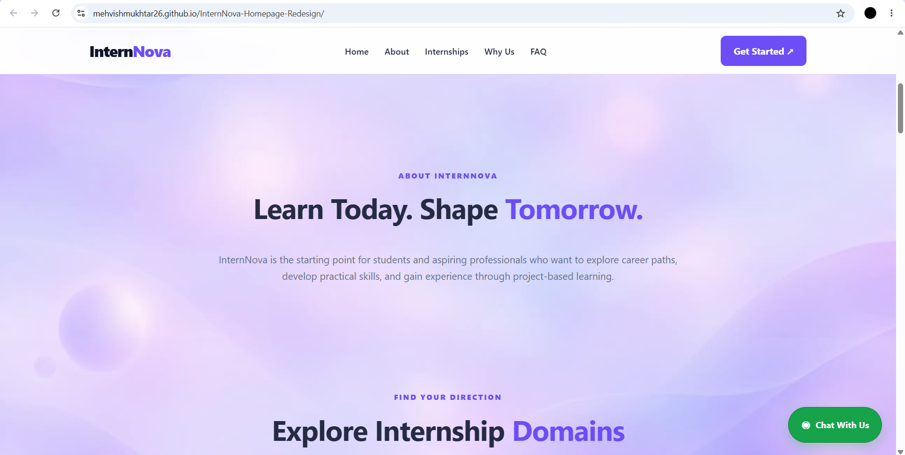

InternNova — Homepage Redesign

A modern, responsive homepage redesign for an internship platform, built using HTML, CSS, and JavaScript.

🔗 Live Demo: "View InternNova Website" (https://mehvishmukhtar26.github.io/InternNova-Homepage-Redesign/)

📌 About the Project

InternNova Homepage Redesign is a front-end web development project focused on creating a clean, engaging, and user-friendly experience for students exploring internship opportunities.

The website features a modern layout, a soft lavender visual theme, responsive sections, and clear navigation to help visitors explore the platform.

📸 Screenshots

Homepage

About and Benefits

Programs and Workshops

Testimonials and Footer

About InternNova

✨ Features

- Responsive Design: Adapts to desktop, tablet, and mobile screens.
- Modern UI: Clean layouts with a soft lavender and purple color palette.
- Navigation Bar: Easy navigation between website sections.
- Hero Section: Welcoming introduction with clear call-to-action buttons.
- Internship Programs: Cards presenting internship-related information.
- Benefits Section: Highlights the learning experience and benefits.
- Learning Section: Presents the learning approach and key points.
- FAQ Section: Expandable questions and answers.
- WhatsApp Contact Button: Provides a convenient contact option.
- Smooth Scrolling: Makes movement between sections more natural.

🛠️ Technologies Used

- HTML5 — Website structure and content.
- CSS3 — Styling, responsive layouts, gradients, animations, and visual effects.
- JavaScript — Interactive website functionality.
- GitHub — Source code hosting and version control.
- GitHub Pages — Website deployment and hosting.

📂 Project Structure

InternNova-Homepage-Redesign/
├── index.html
├── style.css
├── script.js
├── background.jpeg
└── README.md

🚀 Run Locally

1. Clone this repository:
   
   git clone https://github.com/mehvishmukhtar26/InternNova-Homepage-Redesign.git

2. Open the project folder:
   
   cd InternNova-Homepage-Redesign

3. Open "index.html" in your browser, or use the Live Server extension in Visual Studio Code.

🌐 Live Deployment

This project is hosted using GitHub Pages.

Visit the live website:

https://mehvishmukhtar26.github.io/InternNova-Homepage-Redesign/

🎯 Project Objective

The objective of this project is to strengthen front-end development skills through practical experience with responsive layouts, UI styling, website navigation, and deployment.

👩‍💻 Author

Mehvish Mukhtar

- GitHub: "@mehvishmukhtar26" (https://github.com/mehvishmukhtar26)

---

⭐ If you find this project useful or inspiring, feel free to explore the repository and its live demo.
